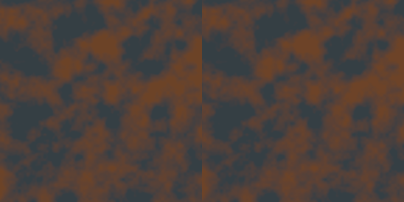

# Smart Material validation

All tests use real production classes. Final validation date: 2026-10-12.

## Coverage and its limits

| Test | What is actually executed |
| --- | --- |
| `SmartMaterialCoreTest` | Canonical layers and ID ownership; opacity/channel blending/order/enable/duplication/removal; v3 round-trip and malformed/desynchronized data; explicit conversion; instance JSON/shared program/packing/error recovery; real atomic IO; 22 new node reference/error cases; Weathered Stone preview and geometry-dependent rejection. |
| `MaterialSubgraphTest` | Graph v4/wrapper v1, all six typed passthrough reference values, defaults, scoped/repeated/nested parameters, preview, UV bake, layer masks, deterministic source, missing assets/resolver, recursion, schema refresh, depth/call/node/ID bounds; actual expanded DXIL/SPIR-V compilation. |
| `MaterialGraphCompilerTest` | Existing CPU arithmetic, textures, HDR/sRGB, normals, layers, cycles/validation, 2048-node traversal, v1/v2 compatibility; all 69 node kinds and three presets compile using actual DXC to DXIL and SPIR-V when configured. Missing DXC is printed as SKIP rather than asserted as GPU validation. |
| `GeometryBakerTest` | Actual plane/convex and inward boxes/concave corner; barycentric maps, seam topology, AO/thickness references, independent curvature/cavity, nonuniform/reflected positions/normals/thickness, padding/source UV, deterministic seed, malformed/overlap cases, cancellation, portable corruption-safe codec and real shared-evaluator/material/raw map preview values; worker completion/cancel. |
| `SmartGeneratorTest` | Six editable preset wrappers/reference values, geometry/context needs, seed determinism/variation, amount/contrast/growth/height controls, gravity rotation anisotropy, zero sizes/directions and large allowed inputs, transactional errors, real geometry mask preview/material bake, canonical layers, repeated call scopes/shared instances; actual DXIL/SPIR-V for every expanded recipe. |
| `MaterialGraphEditorTest` | Production panel/headless ImGui and existing synthetic mouse/key workflow; stack/history; graph/instance/subgraph files, GUID rescan/moves, dependency metadata, changed/malformed/fixed subgraph preview, standalone output, scoped instances; full 256-asset cache and dependency-set replacement. Real OBJ selection/async geometry job/atlas preview/cache save, geometry-bound instance/dependencies and invalid cache preview/reload. New binding dialogs and layer drag-and-drop pixel interactions are not independently automated. |
| `GraphShaderTest` | The four presets compile to SPIR-V in both variants with actual dxc; reflected bindings (static mesh set 0, uniform block, geometry map exactly when geometry data is read); a module rewritten to reach set 3 or an undeclared geometry map is refused; package round-trip, checksum, truncation, foreign file, duplicate bindings and missing variant. |
| `GraphMaterialRenderTest` | Real Vulkan device and the real `StaticMeshRenderer`: a quad with a graph material is drawn into an offscreen scene and the pixel read back. Checks an albedo parameter lit by ambient plus a sampled texture as emissive, the graph pipeline name, a live value from `GraphLiveValues`, a mismatched live block being ignored, a material without a graph drawn from textures, a broken republished package keeping the last shader and a fixed one replacing it. Clean under the Vulkan validation layer with synchronization validation. |
| `MaterialGraphBakingTest` | Actual UV images, native material/ORM and manifest reload; texture imports/moves/renames, bilinear filtering and native GUID lookup with/without a library; missing GUID cannot select a stale path; subgraph authored/effective source snapshots and scoped overrides; geometry-dependent UV export refusal. Actual Assimp OBJ/geometry cache/native source dependency, mesh Weathered Stone images/material/exact cache snapshot, cache/model moves, corruption/recovery and stale source rejection before publication. |

The native baking test also covers existing Assets/Smart files, all six supported
smart extensions, case-insensitive discovery, folder/search queries, manifest
persistence, typed/direct imports with immediate independent GUIDs, and generator
rename/move resolution. The editor test verifies immediate browser visibility after
definition/instance/generator/geometry saves and guarded generator open requests.
The full editor build checks the actual browser double-click/context-menu route;
browser tile pointer interactions are not independently automated.

Asset Browser regression validation on 2026-10-12: full `IxtreemeEngine` Release
build succeeded; the eight-test editor/material selection below passed in 12.07 s.

Quick application tests run the production asynchronous panel pipeline with a real
OBJ, generator graph and scoped instance override, including edits during baking,
automatic publication without a saved input cache, renderer-matching world
positions under rotation/nonuniform scale, and cancellation without publication.
Native assignment checks reject changed models, poses, slots/overrides and different
entity IDs, and preserve unrelated slots/entity metadata. Unsaved geometry also
rejects changed source content before publication. GUI button clicks and an actual
GPU scene capture are not independently automated.

Quick application validation on 2026-10-12: full Release editor build succeeded,
the eight-test selection passed in 14.74 s, and `IXEngineRender` also built with
`IXTREEME_WITH_EDITOR=OFF` (the assignment/transform helpers require no ImGui).

UV repair regression coverage includes tiny exporter roundoff at both atlas borders,
real invalid/non-finite UV rejection, overlapping box UVs, generated seam topology,
atlas cancellation, the production asynchronous fallback, and source edits before
assignment. Reported-model regression modes copy the supplied input into an isolated
temporary project and run both submesh publication and the one-action panel path:

```powershell
build/client-gui-check/libs/render/Release/MaterialGraphBakingTest.exe --model-under-test D:/AkitaOnline/Assets/BlackwaterHollow/Models/LanternPost.glb
build/client-gui-check/libs/render/Release/MaterialGraphEditorTest.exe --model-under-test D:/AkitaOnline/Assets/BlackwaterHollow/Models/LanternPost.glb
```

These do not modify the supplied original or its metadata. The native mode compares
each untouched submesh's triangles directly (positions, normals, UVs and winding),
independent of vertex sharing and face order. `MaterialGraphBakingTest` also runs
this in its default mode on a generated two-material glTF and an OBJ that are
asymmetric along Z and V: the glTF must import exactly as written, and both derived
models must keep the surface their source's renderer path draws. Before 2026-10-14
derived models were mirrored along Z for glTF sources and stored a flipped V on
untouched submeshes. Material-slot cases use a glTF whose primitives use materials
out of order and share one: the slot selects the submeshes drawn with it, a shared
slot bakes, saves and reopens as one surface, and reused UVs across a shared slot
produce a derived model with that slot joined.

`GeometryBakerTest` checks the typed failure reason of every rejection class (UV
layout, other geometry, cancellation) and a sliver triangle kept through the
automatic atlas. `MaterialGraphEditorTest` starts a second Bake & Apply while a
cancelled atlas result is still unpolled; without the fix the stale result stops
that request. It also cancels after the automatic UV model was written and checks
that the model is removed and the preview returns to its source. The pinned MIT xatlas source and license are included under
`Client/third_party/xatlas` for offline builds.

`GraphMaterialRenderTest` reads one graph material's shading back from the GPU and
matches it to the expected lit value; it is not a CPU/GPU parity sweep over every
node kind or preset.

End-to-end check, 2026-10-14. `MaterialGraphBakingTest --publish-into <project>`
published Weathered Metal through the real publication path into a fresh project
(`Client/build/graph-runtime-audit-20261014/project`, not in git). The editor-less
runtime player (`build-runtime`) started that project, loaded the package
(`[GRAPH-MATERIAL] loaded`) and ran clean under the Vulkan validation layer.
`GraphMaterialRenderTest --compare <project> <graph material> <baked copy> <png>`
then drew the material and a copy without its graph shader through the real
renderer: mean absolute difference 0.0003, largest 0.0015 (linear HDR, 256 x 256,
sun and ambient light), so the per-pixel graph matches its CPU-baked textures.
The first run of this check showed the baked copy fully white: publishing gives
the emissive map a factor of 1, but the static mesh shader never sampled emissive
maps, so every published material (and every imported model with an emissive map)
added uniform white light. The static mesh shader now samples the material's
emissive map at set 0 binding 6 (sRGB, white when absent); the comparison was
repeated with the factor of 1 and gave the same difference, and
`GraphMaterialRenderTest` checks that a material's emissive map is sampled.

 The baking and editor tests also check that published
materials carry their compiled package and geometry map, and that a Bake & Apply
material accepts a live parameter edit (exactly one uniform changes, live and in
the saved package) without recompiling. A structural edit is not pushed into the
old shader; it waits for the edits to pause, then compiles in the background into
the same package (new SPIR-V carrying the current values, live values dropped, the
material revision moved), after which parameter edits are live again. Opening
another graph ends the link without compiling it into the published material.
Scene inputs: `MaterialGraphCompilerTest` checks Time, Scene Depth (with and without a
scene, negative fallback), Sky Reflection (zenith looking down, horizon at a
grazing view, turned by the normal), Noise Normal (flat at strength 0, slope
scaling with strength, leaning against the rising noise, computed only when read)
and the Water template (all 67 connections, nine parameters, more foam at the
shore, opaque deep water and clear shallows, stronger reflection at grazing
angles, waves moving with time); every scene node compiles through DXC.
`GraphShaderTest` checks that only a graph with the nodes binds the scene depth
and sky images. `GraphMaterialRenderTest` draws a graph whose emissive colour
carries the time, the depth behind the quad and the sky through the real
renderer, opaque and transparent, with and without a depth copy, and without a
Begin; `GraphMaterialRenderTest --water <out.png> [seconds]` draws the Water
template over a sloping shore as the engine draws a view (sky, depth copy,
transparent pass). Both ran with an empty Vulkan validation log, sync validation
included.

Earlier core geometry-context test values are explicitly supplied. The separate
geometry fixtures and native OBJ/cache tests execute actual baking. GPU resource
lifetime and runtime shader cache tests are future work. Mesh preview is a CPU UV
atlas; native-material asset reload does not prove scene/GPU visual equivalence.

## Reproduction

Editor build configured with C++20, MSVC Release, static vcpkg runtime and
`C:/VulkanSDK/1.4.350.0/Bin/dxc.exe`:

```powershell
cmake -S Client -B build/client-gui-check -DBUILD_TESTING=ON
cmake --build build/client-gui-check --config Release --target SmartGeneratorTest GeometryBakerTest SmartMaterialCoreTest MaterialSubgraphTest MaterialGraphCompilerTest MaterialGraphEditorTest MaterialGraphBakingTest EditorHelpTest IxtreemeEngine -j 4
ctest --test-dir build/client-gui-check -C Release -R '^(SmartGenerator|GeometryBaker|SmartMaterialCore|MaterialSubgraph|MaterialGraphCompiler|MaterialGraphEditor|MaterialGraphBaking|EditorHelp)Test$' --output-on-failure
```

Separate editor-disabled build:

```powershell
cmake -S Client -B build/smart-material-runtime -DIXTREEME_WITH_EDITOR=OFF -DBUILD_TESTING=ON
cmake --build build/smart-material-runtime --config Release --target SmartGeneratorTest GeometryBakerTest SmartMaterialCoreTest MaterialSubgraphTest MaterialGraphCompilerTest -j 4
ctest --test-dir build/smart-material-runtime -C Release -R '^(SmartGenerator|GeometryBaker|SmartMaterialCore|MaterialSubgraph|MaterialGraphCompiler)Test$' --output-on-failure
```

The local run uses source overrides for already fetched Jolt/meshoptimizer trees
to avoid duplicate downloads; binary directories remain separate. This verifies
the new core compiles and runs without ImGui/node-editor UI. It is not a full
editor-disabled player build or gameplay rendering test.

## Final results

| Configuration | Result |
| --- | --- |
| Editor-enabled Release | `IxtreemeEngine`, seven material/geometry/generator targets and `EditorHelpTest` built successfully. |
| Editor material/geometry/generator + help CTest selection | 8/8 passed, 0 failed; 13.04 s total after generator integration and Undo preview correction. |
| Editor-disabled Release core | `IXGeometryBaker`, `IXMaterialGraph`, `SmartGeneratorTest`, `GeometryBakerTest`, `SmartMaterialCoreTest`, `MaterialSubgraphTest`, `MaterialGraphCompilerTest` built successfully. |
| Editor-disabled material/geometry/generator CTest selection | 5/5 passed, 0 failed; 9.20 s total. |
| Shader checks | All 69 operational node kinds, three material presets, an expanded subgraph and all six generator recipes compile to DXIL and SPIR-V through configured DXC; the three structural kinds expand into ordinary instructions. No DXC SKIP in the recorded runs. |
| CPU benchmark | Exit 0; values/method in `SMART_MATERIAL_PERFORMANCE.md`. |
| Updated embedded editor help | `EditorHelpTest` passed in the 8-test selection (0.15 s test time). Updated English/Hungarian help was rebuilt into `IxtreemeEngine`. |

The final tests include removal of the last layer, serialization of an empty
managed stack and adding a new layer afterward. Earlier failures and fixes are
documented in `SMART_MATERIAL_IMPLEMENTATION.md`; no failure is counted as a pass.
The selected material tests are not a claim that the entire repository test suite
ran. Build diagnostics include an existing Inspector local-name shadow warning
and informational LTCG linker messages; builds return success.

Geometry fixture benchmark runs five times with exit 0; methodology, measured
median and exclusions are in `SMART_MATERIAL_PERFORMANCE.md`. The cache/geometry
limits are not a claim that large production meshes or all permitted dimensions
were performance/stress-tested. The full repository CTest suite was not run.

The generator milestone's editor coverage includes actual preset creation/save,
metadata-loss rejection, canonical layer assignment/Undo/Redo, geometry-bound
instance overrides, native dependencies, moves and corruption/recovery. Native
baking tests verify generator authored/effective snapshots and retained scoped
override values. Core tests supply all six recipe reference values and actual DXC.
The separate generator benchmark exits 0; timing exclusions are documented.
