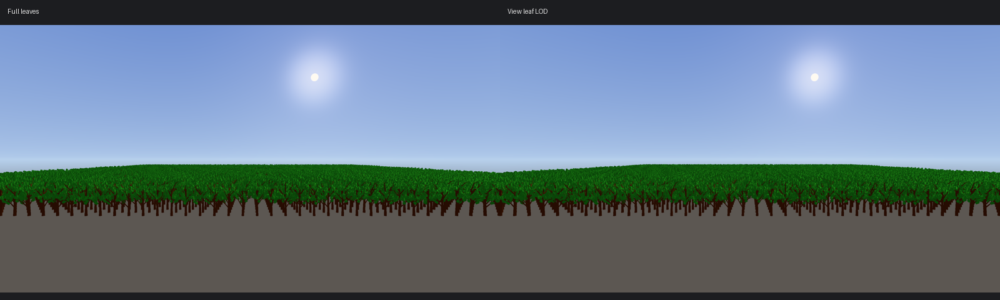

# Hierarchia és fő nézeti levél-LOD — 2026-10-10

A kért sorrendben elkészült a hierarchia változásokhoz kötött újraépítése, a látható sorok kirajzolása, a sokobjektumos mérés és az interakciók ellenőrzése, majd a fő nézet levél-LOD-ja.

## Hierarchia

A Flecs-tükör és az editor hierarchiája csak a lista megjelenését vagy szerkezetét érintő változás után épül újra: objektum hozzáadása/törlése, név, szülő, láthatóság, prefab, note jelölés, fő kamera vagy jelenetváltás. A transform, animáció és a kijelölés nem építi újra a listát. A kijelölés külön, azonosító szerinti kereséssel frissül.

Egy könnyű, pontos metaadat-összehasonlítás továbbra is minden frame-ben végigmegy az objektumokon. Ez O(N), de nem hozza létre újra a szövegeket, indexeket és Flecs-adatokat. A scriptből létrehozott/törölt objektumokat is észleli; nem kell minden módosítási helyre kézzel invalidálást írni.

A megnyitott ágakból és a keresési eredményekből gyorsítótárazott, lapos sorlista készül. Az ImGui clipper csak a panel látható sorait rajzolja. A keresés megtartja a találathoz vezető szülőket. Az ágak nyitott állapota átnevezés és átszülőzés után is megmarad. A bejárás iteratív, ezért egy 10 000 elem mély lánc sem okoz rekurziós veremtúlcsordulást. Új kijelöléshez/átnevezéshez odagörget; változatlan kijelölés nem húzza vissza a felhasználó görgetését.

### Mérés

Release editor, saját tesztprojekt, 10 000 rejtett mesh objektum, üres modellhivatkozásokkal. Ez a hierarchia és a UI költségét méri; nincs benne erdőrenderelés. A referencia ugyanabban a mérőbuildben kikényszeríti a minden frame-es újraépítést és minden sor kirajzolását; az optimalizált út a végleges cache-t és clippert használja. Két-két váltott, 12 másodperces futás, az első három másodperc kihagyva, az utolsó nyolc ablak átlaga:

| Mért érték | Referencia | Optimalizált |
|---|---:|---:|
| FPS | 49,6 | 479,9 |
| CPU frame | 19,97 ms | 2,06 ms |
| Hierarchia frissítése | 11,59 ms | 0,388 ms |
| Editor UI | 5,99 ms | 0,180 ms |

A sorok száma egy 260 pixel magas automatizált tesztpanelben 20 alatt marad 10 000 objektum mellett. A számok nem az üres editor FPS-ére és nem egy renderelt, 10 000 objektumos jelenetre vonatkoznak.

Nyers eredmények: `Client/build/hierarchy-audit-20261010/summary.log`, valamint a négy `run-*-mode-*/samples.json`. Az ideiglenes összehasonlító kapcsolók kikerültek a forrásból.

## Fő nézeti levél-LOD

Automatikusan készül a statikus, alfa-kivágásos modellek sok különálló kis levélkártyájához. Nem kell újramenteni a fát vagy új impostort sütni. Ugyanazt a renderkódot használja a Scene View, Game View és az editor nélküli buildelt játék.

- Teljes modell közelről, majd 75%, 50% és 25% kártyaszám. A szintek determinisztikus, egymásba ágyazott részhalmazok.
- A megtartott kártyák a saját középpontjuk körül nőnek; a teljes kártyafelületet kompenzálják. Az eredeti UV-k, normálok, materialslotok és alfa-kivágás megmaradnak.
- A váltás a felbontást, kamera vetítését, objektum méretét és legközelebbi becsült mélységét veszi figyelembe. A kártyanövelés legnagyobb elmozdulása legfeljebb 1,5 képernyőpixel. Ez a növelés korlátja, nem a teljes képeltérés garantált határa: az elhagyott levelek mintázata változhat.
- A törzs meglévő, 0,5 pixeles felülethiba alapján választott LOD-ja független marad.
- A kijelölt modell teljes részletességű. A nem alkalmas, összefüggő kivágásos mesh, kevés kártya és Blend material teljes geometriát használ. Opaque/Blend materialra váltott levélslot visszaesik az eredeti geometriára.
- A masked mélységi előpassz és színpassz ugyanazt a LOD-geometriát használja. Az egyetlen masked passzal működő út is támogatott. Az árnyék külön, korábbi sűrűségű LOD-t használ.
- Az impostor távolságában a meglévő rendszer vált át az atlaszra. Hiányzó/inaktív impostornál a levél-LOD a távolban is használható.

A felismerés legalább 256 háromszöget, legalább 64 különálló részt és részenként legfeljebb 16 háromszöget vár. Nem általános hálóegyszerűsítés és nem karakter-LOD.

A LOD-kártyák modellbetöltéskor készülnek, a példányok közösen használják a GPU-buffereket. A három fő nézeti szint összesen az eredeti kártyavertexek körülbelül 1,5-szeresét tárolja külön; az árnyékszinttel együtt körülbelül 1,75-szeres extra kártyageometria. Ez fa-modellváltozatonkénti, nem fánkénti többlet. Menet közben nincs új LOD-generálás vagy új kártyabuffer-feltöltés.

Összehasonlításhoz indítás előtt `IX_VIEW_LEAF_LOD=0` kikapcsolja csak ezt a fejlesztést. Alapból bekapcsolt. Az `IX_VIEW_LOD=0` az összes automatikus fő nézeti mesh-LOD-t kikapcsolja. A környezeti kapcsolók az adott folyamat indulásakor olvasódnak.

### Erdőmérés és képek

Saját Release runtime tesztprojekt: 2000 ForestOak, 65–221 m mélységben, normál frustum-cullinggal, azonos fix kamera és 2560×1369 felbontás, alapértelmezett async present, kikapcsolt napárnyék. `IX_TREE_IMPOSTORS=0` és `IX_SCENE_IMPOSTORS=0`, így egyik impostorrendszer sem fedte el a leaf-LOD költségét. A bark-LOD mindkét futásban aktív.

A GPU-képrögzítős próba utolsó öt mérési ablakának mediánja: 162 → 211 FPS, jelenet GPU-idő 5,844 → 4,418 ms. A GPU-kiolvasás két korai frame-ben történt; azok nem esnek az utolsó öt ablakba. A végleges, képrögzítő nélküli Release runtime mérés két 22 másodperces futásban, az utolsó öt 2 másodperces ablak mediánjával:

| Mért érték | Levél-LOD ki | Levél-LOD be |
|---|---:|---:|
| FPS | 164 | 210 |
| Jelenet GPU-ideje | 5.798 ms | 4.485 ms |

FPS-nyereség: 28.0%; a jelenet GPU-ideje 22.6%-kal csökkent. GPU: NVIDIA GeForce RTX 2060. A tesztjelenet terhelése és a nyereség nem vetíthető automatikusan más erdőre, közelképre, árnyékos jelenetre vagy az üres editorra. A forrásfa 6472 háromszögéből 2016 a lomb; levél-LOD szintenként 1512/1008/504 lombháromszög. A végleges mérés alatt nem futott háttérfordítás vagy tesztkészlet.

A lomb fő tömege megmarad, az egyes levelek és a sziluett apró részletei eltérhetnek. A szintek közötti váltás jelenleg nem folyamatos átkeverés; a determinisztikus részhalmaz és a pixelkorlát csökkenti a változás méretét. A közeli teljes részletességű fák terhelését ez nem csökkenti.

### Ellenőrzés

- `HierarchyCacheTest`: metaadat-invalidálás, átnevezés, törlés, átszülőzés, keresés/szülők, ágnyitás, kiválasztott út felfedése, 10 000 mély hierarchia.
- `HierarchyUiTest`: valódi ImGui sorrajzolás szintetikus egér/billentyű eseményekkel; clipper, kijelölés, keresés utáni kijelölés, átnevezés, drag-and-drop és képernyőn kívüli kijelölés/átnevezés, illetve átszülőzés utáni kijelölés-megőrzés. Ez automatizált interakciós teszt, nem kézi UI-ellenőrzés.
- `StaticMeshLeafLodTest`: 17 ellenőrzés, köztük három szint, részhalmazok, UV/normálok, bufferindexek, felületkompenzáció, determinisztikus újraépítés, pixelküszöb, kijelölés, hibás vetítés, Blend/kis/összefüggő háló fallback.
- GPU-képek azonos kamerából, majd Debug runtime napárnyékos terrainnel, Vulkan és szinkronizáció-validációval, masked előpasszal és anélkül. Mindkét validációs futás 0-val zárult; nem jelentett Vulkan-validációs hibát vagy SYNC-HAZARD-ot.

A nyers levél-LOD naplók a `Client/build/followup-audit-20261008/leaf-lod-*-20261010/` könyvtárakban, a fixture és képek a `Client/build/leaf-lod-audit-20261010/` alatt vannak. Az ideiglenes GPU-kiolvasás kikerült a végleges forrásból. Végleges Debug és Release editor/runtime build: sikeres. Editor: mindkét konfigurációban 17/17 CTest; runtime: mindkettőben 16/16 CTest sikeres. Az editor-only ImGui interakciós teszt nincs a runtime konfigurációban. A forrásban nem maradt összehasonlító hierarchia-kapcsoló vagy GPU-képrögzítő. `git diff --check`: sikeres.
