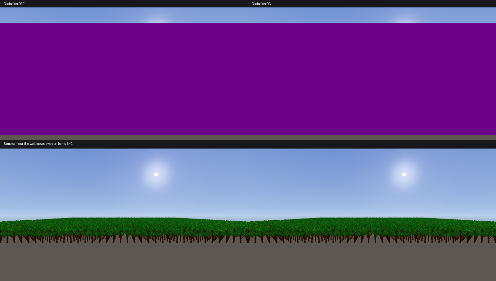

# GPU takarás szerinti szűrés – 2026-10-10

A statikus objektumok és a fák fő nézetének rajzolása most GPU-n kihagyható, ha az egész csoportjukat eltakarja az aktuális képkockában kirajzolt terrain vagy egy nagy, tömör modell. A megoldás közös a Scene View, Game View és az editor nélküli runtime számára. Alapértelmezetten aktív; nem kell újragenerálni a modelleket vagy impostorokat.

## Kapcsolók és visszaállás

- `IX_OCCLUSION_CULLING=0`: teljes kikapcsolás; az eredeti közvetlen rajzolási út működik.
- `IX_OCCLUSION_STATS=1`: időszakos napló, nézetenként a csoportok és kihagyott példányok számával.
- `IX_OCCLUSION_ADAPTIVE=0`: folyamatos futtatás összehasonlításhoz. Normál esetben kevés nyereségnél csak 120 képkockánként próbálja újra.
- Compute, indirect draw vagy az indirect `firstInstance` támogatásának hiányakor, illetve hiányzó shadereknél közvetlen rajzolás marad.

Az adaptív döntés a már elkészült frame-slot kis láthatósági visszaolvasását használja. Legalább 50 000 kihagyható indexpéldány és a vizsgált indexmunka legalább 25%-ának megtakarítása szükséges a folyamatos működéshez. Ez csak az optimalizáló aktiválását szabályozza; a régi láthatóság soha nem rejt el objektumot. Nem tartalmaz CPU/GPU idő alapján szabályozott költségmodellt, ezért CPU-limitnél az extra csoportosítás költsége számít.

## Az aktuális frame menete

1. A terrain és legfeljebb 64 nagy, teljesen opaque statikus objektum a rendes színt és mélységet is kirajzolja. A modellek teljes geometriát használnak; alpha-mask, Blend, átmeneti LOD-fade és a Scene View kijelölt objektuma nem takarómodell. A kiválasztott takarókat ugyanebben a nézetben nem rajzoljuk ki újra.
2. A tároló render pass lezárul, a mélység shaderből olvasható állapotba kerül.
3. Compute shader készít maximum-mélység piramist. Az első szint 16×16 pixel összes mintáját figyelembe veszi, 128 szál/csoport mellett; a további szintek 2×2 maximumot vesznek. Páratlan felbontás, háttér és a mélységben lévő lyukak is megmaradnak.
4. A maradék statikus mesh-példányok rendererenként 16 méteres térbeli cellákba kerülnek. A konzervatív csoporthatár a levél-LOD megnövelt kártyáit és az elforduló tree-impostorokat is körülveszi. A kijelölt objektum közvetlenül rajzolódik.
5. A GPU csak akkor nyilvánít egy csoportot takartnak, ha a teljes vetített téglalap minden lefedett mélységcellája előtte van. Kétpixelnyi bővítés és szigorú mélységi bias védi a széleket. Near/far/viewport-síkot metsző, nem véges vagy kamera mögötti határ látható marad.
6. A GPU a szabványos 20 bájtos indexed indirect parancsok példányszámát nullázza a takart csoportoknál. Az indexszám, első index, vertex offset és first instance változatlan. Compute → indirect, mélység → compute és visszaolvasási barrierek biztosítják a függőségeket.

A bounds és draw-seed tömbök a parancsrögzítés során készülnek el, majd még a queue submission előtt kerülnek a koherens host bufferbe. A GPU a compute parancsok végrehajtásakor már az adott frame adatait olvassa. Nincs külön visibility-fence várás, `WaitIdle`, előző mélység vagy előző kamera alapján történő elrejtés.

Nézetenként két külön, a meglévő BeginFrame fence által védett erőforrás-slot van. A Scene és Game kamera, mélység és indirekt parancsok nem írják felül egymást. Nézetátméretezés csak az éppen újrahasználható slot erőforrásait cseréli. A négy slot összes bufferének nagysága 2560×1369 felbontásnál körülbelül 7,5 MiB; a mélység eleve a nézethez tartozik.

## Hatókör és korlátok

- Statikus opaque és alpha-mask modellek, fák és azok főnézeti levél-LOD/tree-impostor útja használja az indirect szűrést. View-impostor atlasz készítése közben a capture közvetlen rajzolás marad.
- A generikus view-impostor végső, nem indexelt képkártyája jelenleg közvetlen rajzolás marad. Ez együtt tud működni a cullerrel, de ezekre a hatvertexes lapokra még nem vonatkozik az indexed indirect kihagyás.
- A terrain jelenleg takarófelület; terrain-chunkok takarás szerinti kihagyása még nincs. Animált karaktereket, Blend/transparent objektumokat, részecskéket és árnyékpasszokat ez a változtatás nem szűr.
- Lyukas lomb nem használható tömör takaróként. A nyitott erdőben nem feltétlenül van ilyen nyereség; dombok, épületek, sziklák és falak mögött várható.
- Nézetenként legfeljebb 4096 csoport és 32768 indirect parancs. Túlcsorduláskor a rajzolás közvetlen marad. A statikus renderer descriptor-kapacitásából előre tartalékoljuk a még hátralévő, eredeti sorrendű közvetlen batch helyét; a szűrés nem okozhat kapacitás miatti eltűnést.
- A hagyományos CPU mesh/draw/triangle számlálók a beküldött lehetőségeket számolják. A GPU-n nullázott rajzolás miatt ezek nem a ténylegesen végrehajtott háromszögek számát mutatják. A culler saját statisztikája külön adja meg a kihagyott csoportokat és példányokat.
- Nem garantál 6500–7000 üres-editor FPS-t; ez a változtatás takart jelenetgeometria GPU-költségét csökkenti.

## Mozgás és képi ellenőrzés

Saját, 2000 fás runtime tesztprojektben a 512. képkockán még a nagy fal takart; a 640. képkockán a fal 180 méterrel oldalra került. A 640., 641. és 768. frame-ben ugyanaz az erdő látszott bekapcsolt és kikapcsolt szűréssel. A fal mozgatása utáni összehasonlításban a 3,5 millió pixelből hat pixel különbözött három színértéknél többet; eltűnt objektum nem jelent meg. Egy külön 80 méteres kameraugrásnál a négy összehasonlított runtime kép pixelre megegyezett. A méréshez használt fal saját tesztprimitive, placeholder materiallal.

Az editoros próba ugyanazzal a 2000 fás projekttel betöltött, majd külön lebegő Game ablak mellett mindkét nézet futott. A napló nézetenként eltérő csoportszámot és szűrési eredményt mutatott, bekapcsolt tree- és scene-impostorokkal is. Ez automatizált natív futtatás és GPU-képrögzítés volt, nem kézi kattintgatás.

## Végleges teljesítménymérés

NVIDIA GeForce RTX 2060, 2560×1369, Release standalone runtime, alapértelmezett async present, 2000 ForestOak, fix kamera, kikapcsolt napárnyék és god rays. Saját projektek; nincs részecske vagy karakter. Azonos felépítésű, 400×512 méteres terrain két változata: 38 méteres gerinc a kamera és az erdő között, illetve teljesen sík talaj. A nyitott erdőben nincs terrain vagy takarómodell.

Konfigurációnként 18 másodperces futás; az utolsó öt, kétmásodperces naplóablak mediánja. A végleges forrás és bináris használatával, képrögzítő, háttérfordítás vagy tesztkészlet nélkül. Az FPS a present scheduler által ténylegesen bemutatott képkockák számlálója; a GPU-idő ritkábban mintavett teljes frame-idő.

| Jelenet / beállítás | Szűrés ki: FPS | Szűrés be: FPS | GPU frame ki → be |
|---|---:|---:|---:|
| Domb mögötti erdő, tree- és scene-impostor bekapcsolva | 165 | 252 | 5,939 → 3,200 ms |
| Domb mögötti erdő, impostorok kikapcsolva | 191 | 308 | 5,156 → 3,034 ms |
| Nyitott erdő, impostorok kikapcsolva | 208 | 210 | 4,641 → 4,671 ms |
| Sík terrain + erdő, impostorok kikapcsolva | 203 | 201 | 4,696 → 4,885 ms |

A dombos jelenetben bekapcsolt impostorok mellett 52,7% az FPS-nyereség; külön vizsgálva, impostorok nélkül 61,3%. Utóbbinál 138 vizsgált csoportból 76, a 1970 frustumon belüli példányból 1096 maradt GPU-n kihagyható. A nyitott és sík jelenetek FPS-változása körülbelül 1%; ezekben nincs érdemi nyereség. A ritka próba és mérési szórás miatt a GPU-minta mediánja sem feltétlenül javul.

A csoportosításnak CPU-költsége van: impostorok nélkül a dombos jelenet CPU render szakasza 1,251 → 2,619 ms. A GPU-megtakarítás itt nagyobb, ezért nő az FPS; kisebb nézetnél vagy CPU-limitnél más lehet az eredmény. A nyereség nem általánosítható minden kamerára, a közeli erdőre, karakterekre vagy az üres editorra.

## A nagy jelenetben feltárt hierarchiahiba

A próbában a Flecs leállította az editort, mert 2000 testvér ugyanazt a `ForestOak` belső nevet kapta. A Flecs testvérneveknek egyedieknek kell lenniük. A hierarchia belső neve most az ECS azonosítóból készül; a felhasználó által megadott név marad az editorban, keresésben és átnevezésben. Valódi Flecs worlddel hozzáadott regressziós teszt ellenőrzi az azonos megjelenített nevű testvéreket.

## Ellenőrzések

Az `OcclusionCullerTest` CPU része a shader adatméreteket, páratlan mélységpiramisokat, hibás vetítést, clipping-síkokat, nézetenkénti adaptív állapotot, csoportkorlátot és a közvetlen visszaállást vizsgálja. A Windows `--gpu` próba a négy valódi compute shadert futtatja mindkét nézettel és frame-slottal, eltérő páratlan felbontásokon. Fal, egypixeles rés, önmagával egyező mélység, üres háttér, Y-irány és kameraugrás után ellenőrzi az indirect parancsokat, beleértve a negatív vertex offsetet és a nem nulla first instance értéket. A teszt kiolvasási várása kizárólag a tesztben van.

- Végleges Debug és Release editor/runtime build: sikeres.
- Editor CTest: Debug 18/18, Release 18/18; runtime CTest: Debug 17/17, Release 17/17.
- Valódi GPU regresszió: Debug és Release sikeres. Debug Vulkan és szinkronizáció-validáció: nincs VUID vagy SYNC-HAZARD.
- Debug runtime dombos erdő, bekapcsolt impostorokkal és folyamatos szűréssel: szabályos, 0-val zárult; nincs Vulkan-validációs hiba vagy SYNC-HAZARD.
- Mind a négy generált SPIR-V fájl `spirv-val` ellenőrzése sikeres. `git diff --check`: sikeres.

A nyers saját mérési naplók a `Client/build/followup-audit-20261008/occlusion-*/` alatt, a fixture-ek és képi összehasonlítások a `Client/build/occlusion-audit-20261010/` alatt vannak. A három ideiglenesen műszerezett forrásfájlból a tesztloader, mozgási hook és GPU-képrögzítő eltávolításra került.
